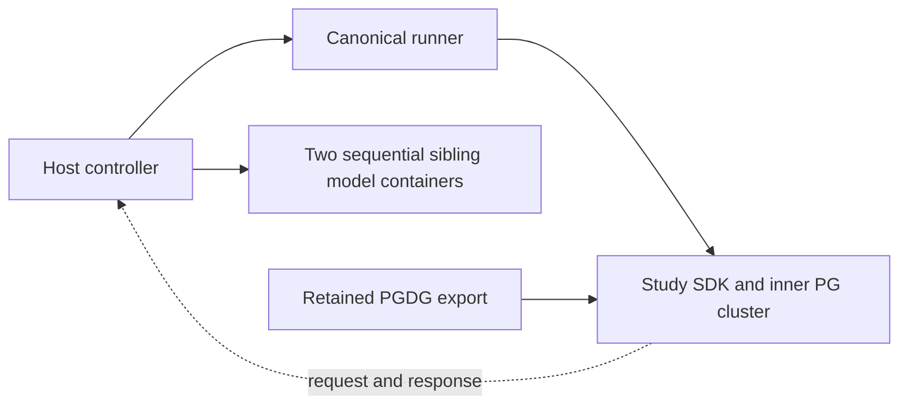

# Proposed W5 supplement native execution contract

Status: proposal under ADR0203, awaiting operator selection. This document is
not an admission record. Current frontend declarations remain inert.

## 1. Milestone and decisions

The proposed phase is CLOE-W5-SUPPLEMENT-STUDY1, checked against current phase
assignments before reservation. It advances three connected epics: exact
execution/ownership admission; one frozen calibration experiment; and complete
paired observation/criteria analysis. Aim for a substantive reviewed milestone
in the operator's 10k–100k changed-line range without padding. Public CI follows
the integrated implementation/evidence milestone, never this design alone.

Route A must explicitly select the opt-in supplement-study runner-policy class,
new native experiment and two representation workers. Dependency/model/data
classes are already selected and unchanged. Route B holds this study and
prepares Local-Rust architecture only. Neither route accepts science or release.

## 2. Immutable experiment identity

Retain all 54 predecessor fixture files, original questions/golds/held-out
values, old journals and CAL5 pins. Do not decode original held-outs. The
supplement input pin is
sha256:c401ff63624c3ed3c0a3b28987cc3b99cacd82907f8a576d51fe56278db98b62.
Use all 24 current tasks, all six declared arms and three repetitions: 432
ordered slots, including every control, refusal and unavailable result.

The six arms remain native-tools search, PostgreSQL current graph, native FTS,
canonical-node-v1 exact vector, public-text-v2 exact vector and public-text
fusion. One generation has two distinct representation exchanges: 66 documents
plus 20 queries = 86 records, and 40 documents plus 20 queries = 60 records. Three retrieval
repetitions reuse the same embeddings and query-once exchange; they do not
create independent relevance samples. No original-generation2/CAL5 identifier
or journal is reused for the second representation.

Reproduce the reviewed input pin, fresh maintained source closure, source
membership and declaration before any supplement adapter executes. The current
prepare/check closure has 314 members; its identity changes after implementation
and must be rederived, not repinned from this proposal. The unchanged flat
17-file model-worker closure remains separately bound. A required kernel/schema
change returns to design review; no silently widened payload is accepted.

## 3. Exact retained inputs

Model: BAAI/bge-small-en-v1.5 revision
5c38ec7c405ec4b44b94cc5a9bb96e735b38267a,384 dimensions, 512 tokens, CPU-only,
ORT_SEQUENTIAL and one intra/inter-op thread. The existing public pin document
tools/retrieval_semantic_generator_pins.json owns all 30 file hashes and versions,
including ONNX Runtime 1.31.1, NumPy 2.5.4 and Tokenizers 0.23.3. All 182,037,753
retained bytes were verified without importing native libraries. Byte verification
does not itself supply the external trusted license/security gate; revalidate
the earlier exact-profile selection and retained gate receipts before admission.
Missing/foreign receipts refuse rather than minting acceptance from a digest.

SDK: sha256:575e0004d8be9a5a8fa73e3301d1e7033280208b9020c1a3155b5d4866598c42,
recipe 24ddf31d8890922c012559d5cab4b1dffe4b41e5b19e9b3438555aabe22d2862.
It is currently cached native linux/arm64. No substitute or emulator is allowed.

PGDG provider manifest: tools/pgvector_test_prebuilt.json,
sha256:b366c8507b36746ea1512c4a9a3d6819214b65203645b7c9555bd450d5f797ec;
package fa7c26fe2f076538915fa7efac6cd944777d891ccb251324bea01fda35626919.
Use the retained runtime export 502,569,984 bytes,
sha256:efa131b8123911f523845d4b36411936a2e63a66c15457cdc5ac86cd4c7a3a66,
config sha256:4b8c5fb11ee4bd545a4cc7db662932d74c8213e0016bbb92d3d6b5809476a1f8.
This image belongs to a disposable inner daemon and is not currently loaded
on the host. Its absence from the host is not a pull/materialization request.
Fresh stream hashing, config/ordered-layer checks and exact provider file
readback must precede import/use inside the new owned SDK.

No downloads, APT/pip network, new dependency, base substitution, source compiler,
image/SDK/application build, runtime rederivation or host installation. Offline
wheel installation inside the existing model-worker sandbox follows its current
hash-locked mechanism only. The old provider/study ledgers remain read-only.

## 3a. Separate identity domains

The declared semantic artifact-profile identity is
sha256:033cf41ffc5ca108b6e26638573554bac64b84be744903809904ef3364722180,
as enforced by the frontend. The canonical pinned-file document identity is
sha256:f0237e38018f3524b87f85f7fff2bef41eda125b8f954d575aaee233541896b6.
The verified profile's source_identity_sha256 binds that pin document plus
the ordered verified file records; its current value is the declared 033cf41f
identity. The model worker must compare request.artifact_profile_identity to
that freshly verified source_identity_sha256, never directly to the pin hash.
Representation-specific embedding profiles and source/evaluator freezes remain
separate identities even if a digest happens to coincide.

The current 17-file model-worker source closure is
sha256:3ef59123fd9281409d42a8e0f4b02471ec3088c54429033d62cbd6b51af01e23,
byte-identical to CAL5. This is neither the artifact pin nor evaluator identity.
Any relevant source change requires the correct fresh closure and review; no
cross-domain hash equality substitutes for recomputation.

## 4. Proposed source and runner authority

Add a closed supplement-study plan/admission type and one opt-in exact owner:
src/test/int/python/tools/retrieval_supplement_native.int.test.py.
Only this selected node, the pgvector experimental profile, current source,
matching frozen input, exact SDK/provider/archive and fresh attempt admission
may invoke the new cohort. Absent, stale, partial, aliased, reused, wrong-role,
wrong-source or lost authority refuses before any SDK/model/query start.

Keep ordinary core behavior and the two existing core/native cohorts unchanged.
Do not broaden their selector sets or turn their historical plans into study
grants. The inert supplement declaration retains zero authority; a separate
parent-issued admission is required. Keep admission/stream/custody facts out of
the old closed model request/result schemas. Public CLI/MCP and canonical graph
vocabulary do not change.

Reuse canonical runner isolation, the offline transport/declaration/context
owners, supplement preparation/capture/report owners, existing semantic arms,
model kernel/worker and current runner-provided ownership attestation. Fresh
private controllers may compose these; they cannot become hidden product or
runner implementations. Bring reusable seams and their tests into maintained
owners before execution and bind every remaining private control source.

The producer may edit only the contribution checkout and phase-owned scratch.
Protect the outer checkout, physical index and every prior receipt. One APGR
dispatcher runs at a time in dynamic_default; no active dispatch interruption.

## 5. Per-attempt finite resource envelope

One fresh study SDK and one owned PostgreSQL lifecycle; one import of the
verified retained runtime; zero runtime materializations/exports/builds/pulls.
Two sequential model workers maximum, one per representation, exactly 146
records total. Retain the existing combined500-record/512-token/4096-byte
excerpt caps; no trimming, task substitution or hidden warm-up requests.

Each model worker retains network-none, read-only root, dropped capabilities,
no-new-privileges,2 GiB memory, 1 CPU, 64 PIDs, 768 MiB scratch and 64 MiB temporary
mount. Existing readiness 120s, initialization 600s and model 550s deadlines remain.
The experimental PG lifecycle retains socket-only,network-none, JIT-off,
2 GiB / 2 CPU / 256 PIDs / 256 MiB tmpfs and no live/source database mount. Controlled
archive/read/transfer limits are 768 MiB per archive, 12 GiB reads, 6 GiB transfers,
8 GiB owned scratch and 4 MiB selected provider content. Counters describe their
controlled streams, not all physical process or PostgreSQL I/O.

The host controller supervises the canonical runner and two sequential model
containers on the host daemon, using the cached SDK image exactly as CAL5 did.
The canonical runner owns one study SDK; its inner daemon imports only the PGDG
runtime and owns the PostgreSQL cluster. No SDK image is loaded into that inner
daemon. The model workers are siblings of the study SDK, not nested containers.
They run only while the runner's live host-pipe ownership attestation remains
valid, returning their bound outputs over the existing request/response path.
Keep the same root-process/CID/source/marker joins and loss-of-authority refusal.

The proposed new supplement-study cohort alone has a 4,800-second SDK lifetime
inside a 5,400-second attempt-controller envelope. Existing core/native SDK
lifetimes remain 1,200 seconds and their command limits remain 300 seconds.
The newly selected cohort is closed separately; no existing plan gains a longer
lifetime. Model phase deadlines stay 600/120/550 seconds. Each sibling worker
has an aggregate 1,700-second envelope, including its existing controlled setup,
validation and cleanup; no inner deadline grows to fill that envelope.

The provisional nested forecast is: two workers = 3,400 seconds, PG import =
300, preparation/index = 300, all query slots = 300, SDK teardown = 300: total
4,600 within 4,800, leaving 200 seconds. Host admission/hash checks = 300,
SDK lifetime = 4,800, final host settlement = 240: total 5,340 within 5,400,
leaving 60 seconds. The 1,270-second existing model phase sum leaves 430 seconds
per worker for its other controlled operations. Final source review must prove
the actual command schedule and aggregate sub-budgets fit, with cooperative
remaining-budget checks and existing bounded waits. Refuse a nonfitting plan;
do not enlarge a default timeout silently. These are controlled-operation
budgets, not a hard native-preemption or physical-I/O guarantee. A time-limited
partial attempt remains failed/incomplete with every observed/unstarted slot
accounted for and cannot claim full study completion.

The controller never signals an existing external dispatcher. Cleanup authority
covers only exact new attempt-owned resources, with identity checks, bounded
settlement and immutable observations; unknown ownership/cleanup blocks reuse.

Actual studies 5 and model-workers 2 carry forward. A successful first physical
attempt would bring them to 6/4. These are forecasts, not preemptive spends or
new cumulative ceilings. Under standing routine allocation, a diagnosed
engineering failure may be corrected and retried with fresh reviewed source,
proof, admission and retained spend. No unchanged failure replay, completed-
result repetition, task/gold/criterion tuning or new study class is granted.

### Controlled-byte forecast

An intentionally conservative planning allowance charges eight maximum 768 MiB
archive read/verification traversals, two 182,037,753-byte artifact passes,
two 32 MiB model responses, two 4 MiB source/selected-data allowances and one 4 MiB
final report: 6,886,218,226 bytes, below 12 GiB. Four maximum-archive-equivalent
transfer hops plus the same nonarchive allowances total 3,664,992,754 bytes,
below 6 GiB. The actual runtime archive is 502,569,984 bytes; provider content is
287,502 bytes within 4 MiB, and owned scratch stays within 8 GiB.

These conservative multipliers describe verification/transport allowances;
they authorize only the one declared runtime import and zero exports. Final
source preparation must replace allowances with its actual bounded command,
source, request, response and report forecast before admission, retaining all
uncertain reservations. A changed forecast must still fit the same caps and
operation counts; a cap conflict refuses. Neither these counters nor the
forecast measures all model/OS/PostgreSQL physical reads.

## 6. Preconditions and evidence

First accept the operator selection, ADR and complete technical scope. Then
implement and independently review the actual run-control and transport seams.
Use separate synthetic tasks for exact scoped unit and containerized integration
proof, with --no-coverage. Cover lost authority at each hop, partial reservation,
wrong slot/source/generation/profile, reordered/missing/duplicate records,
discovery propagation, descendant receipt failure, model/runtime refusal,
exception preservation, partial exports, cleanup failure and no-work-on-refusal.
Run complete static inventory/cohort enforcement; preserve every debt ceiling.
No complete local runtime suite or coverage is selected.

Before queries, bind actual accepted-store node/span/publication/token identities
to the frozen supplement, establish every required gold's reachability, and
retain real tokenizer counts/truncation from the admitted workers. Do not call
product-model tokenization as an uncounted preflight. A truncated required
query/target cannot contribute to the eventual eight-positive paired floor.
If either input delivery exceeds its frozen count or cap, refuse rather than
silently changing the preparation. Source-only applicability remains a forecast.

After actual inference, prove document+query=record=embedding counts, separate
representation/profile/attempt/journal identities, raw response and origin
correspondence, admission/ownership continuity and unchanged task/source bytes.
Evaluate all 432 declared slots with the maintained privacy/refusal order and
grading; retain failed/unavailable/refused/not-run outcomes. Do not replace an
unavailable exact arm with HNSW or metadata fallback. ANN is not selected here.

Observe setup,input/inference/import/index/query/footprint/cleanup/failure work
through existing owned layers. Do not split whole-container time among arms,
sum overlapping layers, or call missing RSS/physical PostgreSQL work measured.
Report unknown, shared and unattributed costs explicitly. No whole-operation
governance or hard-RSS guarantee follows from this experiment.

Require at least eight distinct completed comparable untruncated positive tasks,
two per family, common to all six declared arms before proposing usefulness
criteria. Show the entire denominator and family/control breakdown regardless.
A missed floor or an unhelpful ranking is a valid limitation, not a technical
retry. Criteria and any matching held-out class/overlap disposition return to
the operator; this experiment cannot accept itself scientifically.

### Failed-attempt selection and disclosure

Keep each failed attempt's raw observations, partial slot results, unstarted
slots, spend, cleanup and source identities beside any successor. Never pool,
overwrite or choose a best-scoring attempt. The reported primary calibration
result is the last predeclared technically complete attempt, accompanied by
the whole attempt ledger and every partial predecessor.

Before reserving a technical successor, the parent and an independent APGR
checkpoint must identify a concrete implementation/protocol/transport defect
and its correcting source/regression proof, using separate synthetic inputs
where possible. Poor rankings, a missed comparable-task floor or unexplained
unavailability are not sufficient technical classifications. If evidence cannot
separate a technical fault from a scientific limitation, return that uncertainty
to the operator rather than retrying. Frozen tasks/golds and criteria do not
change, and the experiment may not be repeated to obtain a preferred result.

## 7. Publication and rollback

Only after actual evidence, cleanup, source bindings and independent review
pass may the substantial engineering/evidence milestone use standing staging
publication authority. Observe the next CI ordinal fresh and create a finite
one-use grant carrying actual CI150 application 57 / qualifier 29 / wheels 58 and
component 28 forward. Do not rearm CI150, change triggers, open a replacement
PR or run design-only CI. Main remains released v0.0.4.

Retain every failed attempt, original checkpoint and archive. Rollback removes
only new owned resources. Held-outs, production vectors, new dependencies, parser
classes,live deployment,main/tags/releases and full v0.1.0 acceptance remain
separate. If accepted scope cannot close an essential seam, retain the concrete
finding and return it; never bypass ownership or admission to obtain a result.
